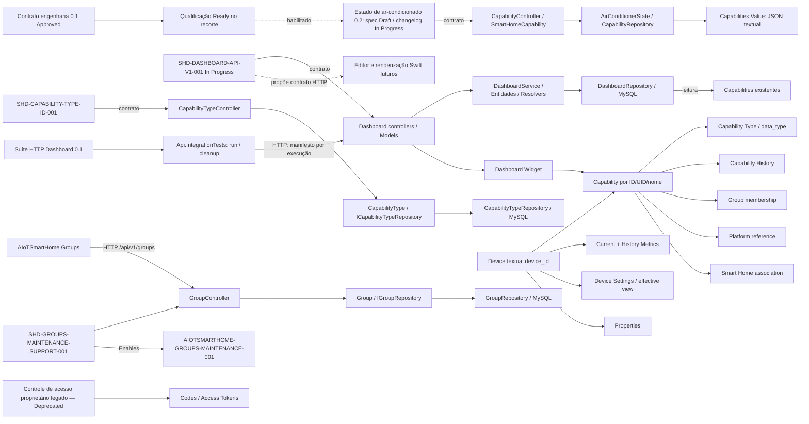

# EKM — Mapa das Fontes de Verdade

**Tipo:** Normativo

**Status:** Active

**Última auditoria:** 24/11/2026

## 1. Governança

| Área | Fonte | Tipo | Estado |
|---|---|---|---|
| Contrato de engenharia (recorte capabilities) | [SHD-ENGINEERING-001@0.1](REPOSITORY-ENGINEERING-CONTRACT.md) | Normativo | Approved 0.1; escopo capabilities |
| Qualificação do recorte | [Repository Readiness](REPOSITORY-READINESS.md) | Operacional | Ready no recorte; aprovação humana registrada |
| Consolidação documental funcional | [SHD-KNOWLEDGE-MAP-001@0.1](../specs/SHD-KNOWLEDGE-MAP-001.md) | Normativo para atividade documental | Approved; implementação documental Done |
| Contratos HTTP gerados | [OpenAPI 3.0.1 / API 1.0](../contracts/openapi.json) e [procedência](../contracts/README.md) | Derivado e informativo | Snapshot fornecido pelo Arquiteto; data e revisão de geração não informadas |
| Bootstrap dos agentes | `AGENTS.md` | Normativo | Active |
| Política de build e validação | `AGENTS.md` + especificação aplicável | Normativo | Active |
| Manutenção obrigatória do conhecimento funcional | `AGENTS.md`, seção "Manutenção obrigatória da base de conhecimento funcional" | Normativo | Active |
| Modelo EKOM vigente | [Repositório oficial, revisão e049856](https://github.com/iotsmartsys/EKOM-guidelines/tree/e0498569169a46257a0f7a278cb48ff17774ded0) | Referência externa | EKOM 5.0; revisão verificada em 23/11/2026 |
| Conceito EKOM | `/Users/marcelocostamiranda/source/EKM-guidelines/docs/EKOM-CONCEPT.md` | Referência externa | EKOM 5.0 na revisão registrada em `AGENTS.md` |
| Método EKOM | `/Users/marcelocostamiranda/source/EKM-guidelines/docs/EKOM-METHOD.md` | Referência externa | EKOM 5.0 na revisão registrada em `AGENTS.md` |
| Governança EKOM | `/Users/marcelocostamiranda/source/EKM-guidelines/docs/GOVERNANCE.md` | Referência externa | EKOM 5.0 na revisão registrada em `AGENTS.md` |
| Coordenação por atores | `/Users/marcelocostamiranda/source/EKM-guidelines/docs/experiments/COORDINATED-ACTOR-MODEL.md` | Protocolo experimental externo | Proposed; não é norma geral |
| Mapa de conhecimento | `docs/rfc/KNOWLEDGE-MAP.md` | Normativo | Active |
| Histórico e transações | `docs/rfc/EKM-CHANGELOG.md` | Operacional | Active |
| Visão do sistema | `docs/specs/SYSTEM-DOSSIER.md` | Informativo | Draft |

## 2. Índice de domínios e autoridade

### 2.1 Referência de produção

**Decisão confirmada pelo arquiteto:** a branch `main` é a referência de
produção do projeto.

As branches `qa` e `homolog` permanecem previstas para adoção futura. Não são
gates obrigatórios enquanto seu processo não estiver especificado e aprovado.

### 2.2 Domínios

| Domínio | Fonte normativa/estado | Implementação principal | Referência informativa | Cobertura descritiva consolidada em 24/11/2026 |
|---|---|---|---|---|
| Devices | `EKM-GAP-0001`; sem contrato funcional geral | `DeviceController`, `Device`, `DeviceRepository`, `DeviceQueryBuilder` | [devices.md](../knowledge/devices.md) | Cinco operações; campos obrigatórios, projeções, transação, erro pós-binding e limites de escrita descritos |
| Capabilities e Capability History | Estado do ar [0.2](../specs/AIR-CONDITIONER-STATE.md); restante `EKM-GAP-0001` | `CapabilityController`, `CapabilityHistoryController`, Core e repositórios | [capabilities.md](../knowledge/capabilities.md) | 22 pares método/rota; aliases, filtros, cache, associações, histórico e divergências descritos |
| Capability Types | [SHD-CAPABILITY-TYPE-ID-001@0.2](../specs/CAPABILITY-TYPE-ID.md), Done | `CapabilityTypeController`, DTO, Core, repository e queries | [capability-types.md](../knowledge/capability-types.md) | Cinco operações; modelo, ID, mapeamento de ícones, transação, erros e limites externos descritos |
| Device Metrics | `EKM-GAP-0001`; schema em `EKM-GAP-0002` | `DeviceMetricsController`, DTO, repository | [device-metrics.md](../knowledge/device-metrics.md) | Três operações; campos/faixas, chave efetiva, duas projeções e paginação descritos |
| Device Settings e Settings globais | Reset normativo [0.1](../specs/DEVICE-SETTINGS-RESET.md); demais `EKM-GAP-0001` | `SettingsController`, `DeviceSettingsController`, repositories/queries | [settings.md](../knowledge/settings.md) | Seis operações; view efetiva, upserts, reset, formatos, transação e falhas descritos |
| Properties | `EKM-GAP-0001` | `PropertiesController`, Core e `PropertyRepository` | [properties.md](../knowledge/properties.md) | Seis operações; construção SQL inválida, upsert, identidade e erro pós-commit descritos |
| Groups | [SHD-GROUPS-MAINTENANCE-SUPPORT-001@0.1](../specs/GROUPS-MAINTENANCE-SUPPORT.md), concluída | `GroupController`, DTOs, Core, repository/queries | [groups.md](../knowledge/groups.md) | Sete operações; contrato normativo separado do PUT legado, associações e snapshot descritos |
| Platforms e Monitored Places | `EKM-GAP-0001` | Controllers, modelos e repositories | [platforms-and-places.md](../knowledge/platforms-and-places.md) | Dois endpoints somente leitura; projeções, statuses e dependência de DDL descritos |
| Smart Home Capabilities | `EKM-GAP-0001` | `SmartHomeCapabilityController`, modelo Capability e query builder | [smart-home-capabilities.md](../knowledge/smart-home-capabilities.md) | Duas consultas; filtro por nome e lookup por UID sem escopo descritos |
| Dashboards, widgets e catálogo | [SHD-DASHBOARD-API-V1-001@0.3](../specs/DASHBOARD-API-V1.md); aceite operacional pendente | Controllers, `DashboardService`, resolvers e `DashboardRepository` | [dashboards-and-widgets.md](../knowledge/dashboards-and-widgets.md) | Doze operações; contrato normativo, regras de criação/PUT, compatibilidade e limite operacional separados |
| Endpoints utilitários | Sem contrato funcional próprio localizado | Minimal APIs em `Program.cs`, response model e watchdog | [utility-endpoints.md](../knowledge/utility-endpoints.md) | Três endpoints; timezone local, health sem DB e watchdog separados |
| Controle de acesso legado | Estado Deprecated conforme decisão humana; contrato funcional não especificado | `OAuthController`, entidades/repos OAuth, DI | [legacy-access-control.md](../knowledge/legacy-access-control.md) | Três operações proprietárias; campos, fluxo de codes/tokens, erros e concorrência descritos; uso atual permanece contexto informado |
| Persistência geral | `EKM-GAP-0002` | `src/Data.Repositories`, `database/` | Referências por domínio acima | Inventário parcial; schema e views autoritativos ausentes |
| Suíte HTTP Dashboard | [SHD-DASHBOARD-API-INTEGRATION-TESTS-001@0.1](../specs/DASHBOARD-API-INTEGRATION-TESTS.md) | `tests/Api.IntegrationTests`, `Makefile` | [Dossier §9](../specs/SYSTEM-DOSSIER.md) e relatório da suíte | Criada/compilada; cenários não executados |
| Build, imagem e operação | `AGENTS.md` + especificação aplicável | API csproj, Dockerfile, workflow, scripts e compose | [SYSTEM-DOSSIER](../specs/SYSTEM-DOSSIER.md) | Mapped parcialmente; caminhos de publicação diferem |

**Divergência de estado preservada:** o cabeçalho de
[`AIR-CONDITIONER-STATE.md`](../specs/AIR-CONDITIONER-STATE.md) declara workflow
`Draft`; o [EKM-CHANGELOG](EKM-CHANGELOG.md) registra workflow `In Progress`,
código/build entregues e validação HTTP/MySQL pendente. Este mapa não decide
qual rótulo prevalece. A referência funcional descreve código local e mantém
essa diferença como informação normativa/histórica a resolver pela autoridade
humana.

**Inventário e cobertura por operação:** o snapshot OpenAPI e controllers identificam 76 pares método/rota. O [relatório independente de 24/11/2026](../reports/DEVICE-API-DOCUMENTATION-AUDIT/2026-11-24-43fbdc0/DEVICE-API-DOCUMENTATION-AUDIT.md) preserva evidências e limitações; a [matriz consolidada](../reports/DEVICE-API-KNOWLEDGE-CONSOLIDATION/DEVICE-API-CONSOLIDATED-KNOWLEDGE-COVERAGE.md), a [reconciliação dos treze achados](../reports/DEVICE-API-KNOWLEDGE-CONSOLIDATION/DEVICE-API-AUDIT-KNOWLEDGE-RECONCILIATION.md), as [lacunas residuais](../reports/DEVICE-API-KNOWLEDGE-CONSOLIDATION/DEVICE-API-RESIDUAL-KNOWLEDGE-GAPS.md) e o [relatório da intervenção](../reports/DEVICE-API-KNOWLEDGE-CONSOLIDATION/DEVICE-API-KNOWLEDGE-CONSOLIDATION-IMPLEMENTATION.md) acompanham o estado. O inventário inclui aliases e três rotas proprietárias legadas; não significa exposição pública nem autoridade normativa integral.

## 3. Árvore de conhecimento

```text
SmartHome-DeviceApi
├── Contratos normativos
│   ├── Contrato de engenharia 0.1 (Approved; capabilities)
│   ├── Repository Readiness (Ready no recorte aprovado)
│   ├── Estado composto de ar-condicionado (0.2; spec Draft / changelog In Progress; divergência preservada)
│   ├── Dashboard API v1 (In Progress; reimplementação para Revisão)
│   ├── Suíte HTTP Dashboard (In Progress; criada/compilada, não executada)
│   ├── Capability Types por id (Done)
│   ├── Suporte à manutenção de Groups
│   ├── SHD-KNOWLEDGE-MAP-001@0.1 (Approved; implementação documental Done)
│   └── Contratos funcionais ainda abertos em EKM-GAP-0001
├── API e modelos HTTP
├── Core e contratos de repositório
├── Persistência MySQL
├── Referências informativas por domínio
│   ├── Devices, Capabilities/History, Capability Types, Metrics
│   ├── Settings, Properties, Groups, Platforms/Places, Smart Home
│   ├── Dashboards/Widgets e endpoints utilitários
│   └── Controle de acesso proprietário legado — Deprecated
└── Consumidores
    └── AIoTSmartHome — manutenção de Groups
```

## 4. Diagrama de relações

O [inventário integral OpenAPI e confronto com controllers](../reports/SHD-KNOWLEDGE-MAP/2026-11-23T211211Z-c31c6cb4-2d80-42cd-9fbf-9dd40921395c-openapi-reconciliation.md) enumera os 76 pares método/rota e referencia a documentação funcional de cada domínio. O JSON é evidência de contrato HTTP gerado, não autoridade normativa.



## 5. Lacunas

| ID | Estado | Lacuna | Critério de encerramento | Dependência |
|---|---|---|---|---|
| `EKM-GAP-0001` | Open | Parte dos contratos funcionais vigentes ainda não possui especificações EKM próprias; o reset de settings específicos de device foi coberto por `SHD-SETTINGS-RESET-001@0.1`, permanecendo os demais recortes em aberto. | Criar e aprovar especificações incrementalmente por domínio, usando specification on touch. | Priorização do arquiteto e mudanças funcionais. |
| `EKM-GAP-0002` | Open | O schema MySQL completo e sua autoridade de criação/migração não estão preservados no repositório; há scripts parciais e um `init.sql` com sintaxe de outro SGBD. | Identificar e registrar a fonte autoritativa do schema MySQL, incluindo tabelas e views consumidas pelas queries. | Inventário do banco vigente e decisão sobre migrações. |
| `EKM-GAP-0003` | Open | A suíte `tests/Api.Tests` foi descontinuada globalmente por decisão humana e deve permanecer ignorada; porém, `src/SmartHome-Api.sln` ainda referencia o projeto histórico e não existe uma estratégia automatizada substituta geral para os demais domínios. | Remover a referência legada da solução em mudança autorizada e garantir que cada especificação afetada declare evidências de validação suficientes, sem reativar ou reparar `tests/Api.Tests`. | Reconciliação de implementação separada e especificações incrementais. |
| `EKM-GAP-0004` | Open | A política de segredos e configurações operacionais não está documentada, e existe configuração sensível em artefato versionado de deploy. | Remover segredos versionados, rotacionar os valores afetados e documentar a fonte segura de configuração. | Decisão e execução operacional autorizadas. |
| `EKM-GAP-0005` | Open | O apontamento absoluto para a EKM externa é específico da máquina e não possui resolução portátil. | Especificar e validar um mecanismo portátil quando o experimento exigir execução em outra máquina ou automação. | Evidência de necessidade; não bloqueia o experimento local. |

## 6. Débitos técnicos

Nenhum débito técnico foi aceito pelo Arquiteto neste mapa. Lacunas e riscos
observados permanecem na seção 5 até decisão humana de disposição.

## 7. Análise de Capability Types por id

Análise: `docs/reports/CAPABILITY-TYPE-ID/analysis/2026-09-05T011011Z-0567d22b-92cb7a87-7715-44ab-b007-9a3acecb5b82-implementability-analysis.md`.
Classificação `Ready` para a versão 0.2, SHA-256 `0567d22b2b1a3b0a376893a6b52cf67e1d071309472bba89b70ec12b5042066d`.
Implementação: `docs/reports/CAPABILITY-TYPE-ID/implementation/2026-09-05T011121Z-0567d22b-3af01aa2-0190-4147-9641-18a4b5044986-implementation.md`.
GET individual somente em `/api/v1/capabilities-types/{id}`; Location do POST
por id. Versão 0.2 Concluída (`Done`) por decisão humana após declaração de
validação e testes; promoção para main autorizada.
O SHA-256 identifica o snapshot analisado; os metadados de estado e o registro
da decisão de encerramento foram atualizados posteriormente, sem mudança
funcional. Relatórios anteriores permanecem históricos.

## 8. Manutenção

Atualize este mapa quando uma fonte, autoridade, responsabilidade, evidência,
estado ou lacuna mudar. Não remova uma entrada sem indicar o destino do
conhecimento.
